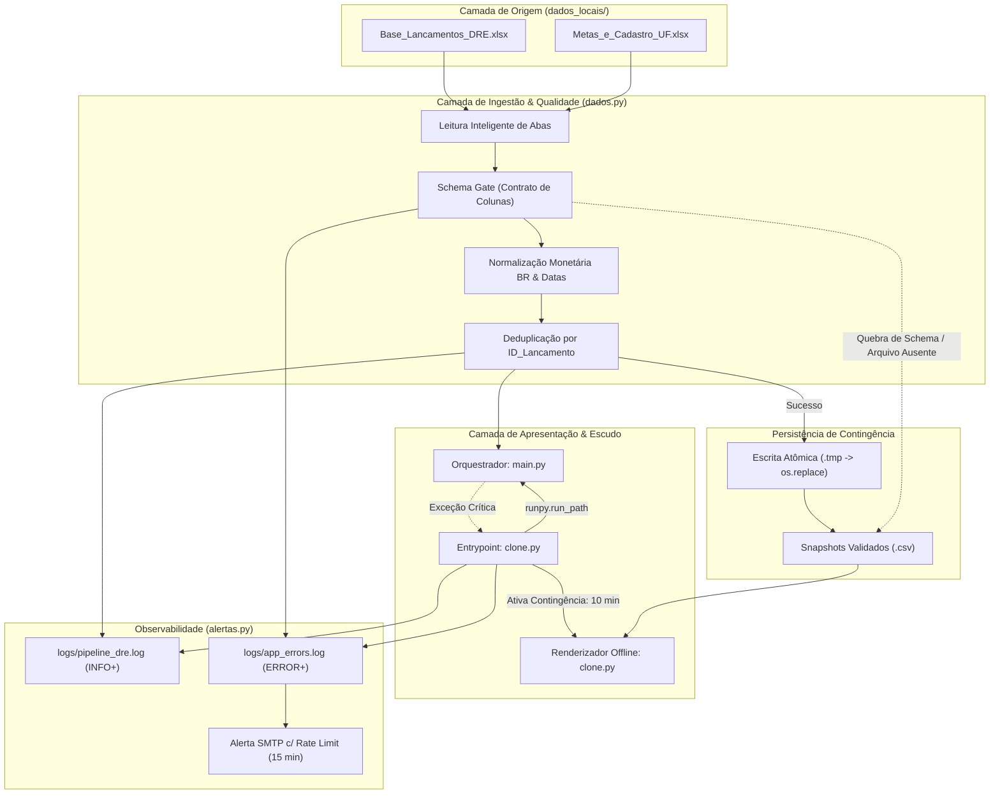
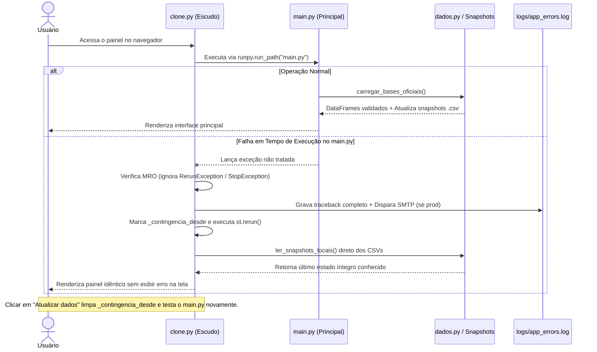

<div align="center">

# Balanço Regional — DRE, Orçamento & Eficiência Logística por UF

Aplicação analítica construída em **Python** e **Streamlit** para consolidação de Demonstrativo de Resultado do Exercício (DRE), controle de teto orçamentário e auditoria de custos de frete por Unidade Federativa, apoiada por um pipeline local tolerante a falhas com validação de contrato, snapshots atômicos e contingência automática.


[Visão Geral](#visão-geral-e-problema-de-negócio) · [Estudo da Base](#estudo-da-base-de-dados-jan-nov-2026) · [Engenharia e Resiliência](#engenharia-de-dados-e-arquitetura-de-resiliência) · [Páginas da Aplicação](#páginas-e-recursos-visuais) · [Regras da DRE](#regras-de-negócio-e-fórmulas) · [Como Executar](#instalação-e-execução) · [Chaos Testing](#laboratório-de-resiliência-chaos-test)

</div>

---

<!-- Espaço reservado para GIF ou screenshot do projeto em execução -->
<!--  -->

## Visão Geral e Problema de Negócio

Em operações comerciais distribuídas pelo território brasileiro, avaliar unidades regionais apenas pelo volume de faturamento bruto costuma distorcer a tomada de decisão. Estados com alta demanda frequentemente sofrem compressão severa de margem por conta de malha logística dedicada, frete de longa distância, tributação interestadual e custos fixos de estrutura.

Este projeto resolve duas frentes complementares:

1. **Visão de Controladoria e Logística (Negócio):** cruza faturamento bruto, impostos, CMV, frete por modal e despesas operacionais para revelar onde a empresa realmente gera caixa, onde o teto de gastos está sendo respeitado e quais rotas logísticas corroem o resultado.
2. **Confiabilidade Operacional em Produção (Engenharia):** operações reais que dependem de planilhas corporativas em diretórios de rede sofrem com abas renomeadas, colunas alteradas sem aviso, erros de codificação e arquivos corrompidos durante salvamento. Em vez de um script único que quebra com `Traceback` na tela do gestor, o projeto implementa validação estrita de schema, espelhamento atômico e um módulo interceptador (`clone.py`) que mantém o painel disponível em modo de contingência.

---

## Estudo da Base de Dados (Jan–Nov 2026)

O repositório acompanha duas planilhas sintéticas calibradas para simular um cenário realista de distribuição nacional entre janeiro e novembro de 2026 (**1.694 lançamentos financeiros**, **168 metas mensais** e **14 UFs** distribuídas nas 5 macro-regiões).

No consolidado acumulado do período, a operação registra **R$ 94,61 mi** em Receita Bruta (96,2% da meta de R$ 98,32 mi), **R$ 79,83 mi** em custos e despesas totais (gerando economia de **R$ 1,72 mi** frente ao teto orçado de R$ 81,54 mi) e **R$ 14,78 mi** de Lucro Líquido (**15,6%** de margem líquida, com peso médio de frete em **13,0%**).

### Contraste Estratégico entre Estados

A tabela abaixo ilustra a tese central explorada nos visuais do painel — por que o líder de vendas não é o líder de lucro:

| UF | Modal Principal | Receita Bruta | Peso do Frete | Lucro Líquido | Margem Líquida | Diagnóstico Executivo |
| :--- | :--- | :---: | :---: | :---: | :---: | :--- |
| **SP** | Rodoviário Dedicado | R$ 17,99 mi | 16,5% | R$ 1,32 mi | **7,3%** | Maior faturamento da empresa, mas entrega menos lucro nominal que MG e PE devido ao custo de distribuição dedicada e estrutura. |
| **MG** | Rodoviário Misto | R$ 10,55 mi | 9,8% | R$ 2,40 mi | **22,8%** | Maior gerador absoluto de caixa líquido da companhia, equilibrando escala comercial e frete controlado. |
| **PE** | Hub Regional + Cabotagem | R$ 7,37 mi | 8,7% | R$ 1,89 mi | **25,7%** | Líder nacional em rentabilidade percentual, beneficiado pelo uso de cabotagem e distribuição via hub regional. |
| **AM** | Fluvial + Aéreo Urgente | R$ 2,85 mi | 27,9% | -R$ 97,2 mil | **-3,4%** | Operação deficitária; quase 28% de tudo o que é faturado na unidade é consumido por frete fluvial e aéreo emergencial. |

<details>
<summary><b>Expandir desempenho consolidado por Macro-Região e Mix de Canais</b></summary>

<br>

**Resultado Acumulado por Macro-Região:**

| Macro-Região | Receita Bruta | Gasto com Frete | Peso do Frete (%) | Lucro Líquido | Margem Líquida (%) |
| :--- | :---: | :---: | :---: | :---: | :---: |
| **Nordeste** (PE, BA, CE) | R$ 18,76 mi | R$ 1,96 mi | 10,5% | R$ 4,11 mi | **21,9%** |
| **Centro-Oeste** (GO, DF) | R$ 8,62 mi | R$ 987,5 mil | 11,5% | R$ 1,69 mi | **19,6%** |
| **Sul** (PR, SC, RS) | R$ 19,95 mi | R$ 2,27 mi | 11,4% | R$ 3,51 mi | **17,6%** |
| **Sudeste** (SP, RJ, MG, ES) | R$ 41,13 mi | R$ 5,59 mi | 13,6% | R$ 5,46 mi | **13,3%** |
| **Norte** (PA, AM) | R$ 6,15 mi | R$ 1,53 mi | 25,0% | R$ 4,5 mil | **0,1%** |

**Participação na Receita Bruta por Canal Comercial:**
* **B2B Corporativo:** 36,6%
* **E-commerce:** 23,8%
* **Varejo Direto:** 20,6%
* **Distribuidor:** 19,0%

</details>

---

## Engenharia de Dados e Arquitetura de Resiliência

O código foi fatiado em módulos independentes seguindo separação estrita de responsabilidades: ingestão e qualidade (`dados.py`), regras de caminho (`caminhos.py`), observabilidade (`alertas.py`), componentes gráficos (`graficos.py`), controles de estado e UI (`interface.py`), estilização (`estilo.py`), orquestração (`main.py`) e alta disponibilidade (`clone.py`).

### 1. Fluxo de Dados e Camadas de Proteção


### 2. Decisões Técnicas Implementadas

* **Inspeção Inteligente de Abas e Codificação (`dados.py`):** se alguém renomear uma aba no Excel (por exemplo, de `Metas_UF` para `Planilha1`), a função `_ler_aba_inteligente` varre as abas disponíveis comparando a assinatura das colunas contra o contrato esperado antes de levantar erro. Na leitura de contingência (`_ler_csv_seguro`), o pipeline testa múltiplos *encodings* comuns no Windows (`utf-8-sig`, `utf-8`, `cp1252`, `latin-1`) e detecta via *magic bytes* (`PK\x03\x04`) caso um arquivo binário `.xlsx` tenha sido salvo acidentalmente com extensão `.csv`.
* **Escrita Atômica de Snapshots (`salvar_snapshot_atomico`):** toda carga saudável do Excel gera espelhos CSV limpos. Para evitar que uma queda de energia ou interrupção no meio da gravação deixe um CSV truncado/corrompido, o sistema grava primeiro em um arquivo `.tmp` e executa substituição atômica no sistema de arquivos (`Path.replace`).
* **Interceptação Seletiva de Exceções (`clone.py`):** internamente, comandos normais do Streamlit como `st.rerun()` e `st.stop()` funcionam disparando exceções Python. Se o escudo capturasse `Exception` de forma cega, qualquer clique em "Atualizar dados" acionaria falso alarme de queda. O `clone.py` inspeciona a árvore de herança (`__mro__`) da exceção, deixa sinais de controle do framework passarem livremente e só assume o controle diante de falhas reais de execução.
* **Isolamento de Estado entre Principal e Clone:** todos os widgets renderizados em modo de contingência recebem sufixo dedicado (`_clone`) nas `keys` do `st.session_state`, evitando colisão de memória ao alternar entre o `main.py` e o `clone.py`.
* **Logs Rotativos e Trava Anti-Inundação de E-mail (`alertas.py`):** dois `RotatingFileHandler` limitam cada arquivo de log a 5 MB (mantendo até 3 históricos). Em ambiente de produção, o envio de alertas SMTP utiliza `threading.Lock` com janela mínima de 15 minutos por título de erro — impedindo que 50 acessos simultâneos durante uma instabilidade disparem 50 e-mails idênticos.

### 3. Ciclo de Vida do Self-Healing (`clone.py`)



---

## Páginas e Recursos Visuais

Optou-se por construir os gráficos analíticos via injeção de **ApexCharts** (`st.components.v1.html`) em vez dos gráficos nativos básicos do Streamlit, permitindo controle fino de tipografia numérica tabular (`font-variant-numeric: tabular-nums`), badges translúcidos de alto contraste sobre fundo escuro e formatação monetária brasileira tanto nos rótulos quanto nos *tooltips*.

### Rota 1 — Painel Principal (DRE & Execução Orçamentária)
* **Grade 3x2 de KPIs:** Receita Bruta (% atingido da meta), Lucro Líquido, Margem Líquida (desvio em pontos percentuais contra a meta), Custos & Despesas (% consumido do teto), Saldo do Teto de Gastos (economia gerada ou estouro orçamentário) e Peso do Frete sobre a Receita.
* **Cascata da DRE (*Waterfall*):** decomposição visual em barras flutuantes (`rangeBar`) partindo da Receita Bruta, deduzindo Impostos, CMV, Frete e Despesas Operacionais até o Lucro Líquido.
* **Evolução Mensal Híbrida:** gráfico combinado de colunas agrupadas (Receita vs. Custos mês a mês) sobreposto pela curva de Margem Líquida (%) no eixo secundário, mantendo a série anual visível mesmo quando um mês individual é filtrado na barra lateral.
* **Ranking de Margem por UF & Mix de Canais:** barras horizontais categorizadas por faixa de saúde financeira (verde `>= 15%`, laranja `0% a 15%`, vermelho `< 0%`) ao lado de gráfico de rosca com KPI dinâmico no centro (atualiza o valor ao passar o cursor sobre cada canal).
* **Razão Analítico:** tabela detalhada com filtros combinados de rubrica e canal, acompanhada de exportação direta para CSV UTF-8 (`utf-8-sig`, pronta para abrir no Excel sem quebrar acentos).

### Rota 2 — Logística, Fretes & Modais
* **Filtros Operacionais de Transporte:** seleção por `Modal_Principal` (Rodoviário Dedicado, Cabotagem, Fluvial + Aéreo, etc.) e controle deslizante (`slider`) para isolar estados acima de um percentual mínimo de impacto de frete.
* **KPIs de Distribuição:** gasto logístico total do recorte, peso médio sobre a receita e identificação automática da UF mais onerosa e da mais eficiente.
* **Visuais Dedicados:** ranking horizontal de peso de frete por estado, rosca de consumo de frete por canal de venda e listagem exclusiva das faturas/lotes logísticos com download independente em CSV.

### Rota 3 — Mapa Geográfico 3D / 2D (PyDeck)
* ** Alternância 3D e 2D:** renderização WebGL via `pydeck` alternando entre `ColumnLayer` (colunas 3D com câmera inclinada a `42°` cuja elevação reflete o volume financeiro escolhido) e `ScatterplotLayer` (bolhas 2D proporcionais), mantendo fallback automático para `st.map` caso `pydeck` não esteja instalado.
* **Seis Controles Geoespaciais:** escolha da grandeza que dimensiona a altura/raio (`Receita Bruta`, `Lucro Líquido`, `Frete & Logística` ou `Custos Totais`), filtro por faixa de rentabilidade, modal logístico, gerente regional e *checkbox* para destacar apenas UFs operando abaixo da meta de margem.
* **Tooltip Rico e Tabela de Apoio:** cartão flutuante em HTML escuro ao passar o cursor sobre cada estado exibindo responsável, modal, receita, frete, lucro e margem, seguido da matriz comparativa das UFs filtradas.

---

## Regras de Negócio e Fórmulas

Todas as agregações financeiras ficam centralizadas na camada analítica de `dados.py` (`calcular_kpis_dre` e `consolidar_dados_mapa`), garantindo que o Painel Principal, a tela de Logística, o Mapa e o Clone exibam rigorosamente os mesmos números:

```text
Custos_Totais   = Impostos + CMV + Frete_Logistica + Despesas_Operacionais
Lucro_Liquido   = Receita_Bruta - Custos_Totais
Margem_Liquida  = (Lucro_Liquido / Receita_Bruta) * 100
Desvio_Margem   = Margem_Liquida - Meta_Margem_Media_Pond          [em pontos percentuais (p.p.)]
Saldo_Teto      = Teto_Custos_Despesas - Custos_Totais             [> 0: Economia | < 0: Estouro]
Peso_Frete      = (Frete_Logistica / Receita_Bruta) * 100
```

<details>
<summary><b>Expandir Dicionário de Dados e Contratos das Planilhas (.xlsx)</b></summary>

<br>

**1. Arquivo `Base_Lancamentos_DRE.xlsx` — Aba `Lancamentos`**

| Coluna | Tipo Esperado | Regra no Pipeline (`dados.py`) |
| :--- | :--- | :--- |
| `ID_Lancamento` | `string` | Chave única do lote (`DRE-26-XXXX`); usada na deduplicação (`keep="last"`). |
| `Data` | `date` | Convertida via `pd.to_datetime`; linhas com data inválida são descartadas. |
| `Mês_Num` | `int` | Competência numérica (`1` a `12`); preenchida a partir de `Data` caso vazia. |
| `UF` | `string` | Sigla do estado padronizada em caixa alta (`SP`, `MG`, `PE`, etc.). |
| `Estado` | `string` | Nome por extenso da Unidade Federativa. |
| `Região` | `string` | Macro-região geográfica (`Norte`, `Nordeste`, `Centro-Oeste`, `Sudeste`, `Sul`). |
| `Grupo_DRE` | `string` | Rubrica contábil: `Receita Bruta`, `Impostos`, `CMV`, `Frete & Logística` ou `Desp. Operacionais`. |
| `Natureza` | `string` | `Entrada` ou `Saída`. |
| `Canal` | `string` | Canal comercial (`B2B Corporativo`, `E-commerce`, `Varejo Direto`, `Distribuidor`, `Operação Geral`). |
| `Descrição` | `string` | Histórico resumido do lançamento. |
| `Valor` | `float` | Aceita float nativo ou string monetária BR (`R$ 1.234,50`), normalizada sem erro de escala decimal. |

*Nota: o arquivo também inclui a aba `Resumo_DRE_UF` com fórmulas `SUMIFS` nativas do Excel para auditoria externa dos saldos.*

**2. Arquivo `Metas_e_Cadastro_UF.xlsx` — Abas `Metas_UF` e `Cadastro_Estados`**

| Aba | Colunas Obrigatórias | Finalidade no Sistema |
| :--- | :--- | :--- |
| `Metas_UF` | `UF`, `Região`, `Mês`, `Meta_Receita`, `Teto_Custos_Despesas`, `Meta_Margem_Pct` | Cálculo de atingimento comercial, desvio de margem em p.p. e saldo do teto de gastos. |
| `Cadastro_Estados` | `UF`, `Estado`, `Região`, `Lat`, `Lon`, `Gerente_Regional`, `Modal_Principal` | Coordenadas geográficas para o PyDeck e metadados de filtro logístico/gestão. |

</details>

---

## Estrutura de Diretórios

```text
.
├── dados_locais/
│   ├── Base_Lancamentos_DRE.xlsx     # Fonte primária transacional (1.694 lançamentos)
│   ├── Metas_e_Cadastro_UF.xlsx      # Orçamento mensal (168 linhas) e cadastro geográfico (14 UFs)
│   ├── snapshot_lancamentos.csv      # Espelho atômico gerado automaticamente pelo ETL
│   ├── snapshot_metas.csv            # Espelho atômico de metas
│   └── snapshot_estados.csv          # Espelho atômico cadastral
├── logs/
│   ├── pipeline_dre.log              # Auditoria operacional (latência em ms, volumetria, avisos)
│   └── app_errors.log                # Registro isolado de exceções críticas e acionamentos do clone
├── clone.py                          # Entrypoint recomendado: escudo de alta disponibilidade
├── main.py                           # Orquestrador das 3 rotas analíticas
├── dados.py                          # Pipeline ETL, validação de contrato, snapshots e cálculos DRE
├── graficos.py                       # Gráficos customizados em ApexCharts e mapa 3D/2D em PyDeck
├── interface.py                      # Sidebar, controle de rotas, filtros e monitor visual de logs
├── estilo.py                         # Design system CSS (tema escuro), constantes e formatadores
├── alertas.py                        # Handlers de log rotativo e cliente SMTP com rate-limiting
├── caminhos.py                       # Resolução dinâmica de caminhos multiplataforma (pathlib)
└── requirements.txt                  # Dependências do projeto
```

---

## Instalação e Execução

### Pré-requisitos
* Python **3.11** ou superior instalado.

### Passo a Passo

**No Windows (PowerShell):**
```powershell
git clone [https://github.com/SEU_USUARIO/NOME_DO_REPOSITORIO.git](https://github.com/SEU_USUARIO/NOME_DO_REPOSITORIO.git)
cd NOME_DO_REPOSITORIO

python -m venv .venv
.\.venv\Scripts\Activate.ps1

pip install -r requirements.txt
streamlit run clone.py
```

**No Linux / macOS:**
```bash
git clone [https://github.com/SEU_USUARIO/NOME_DO_REPOSITORIO.git](https://github.com/SEU_USUARIO/NOME_DO_REPOSITORIO.git)
cd NOME_DO_REPOSITORIO

python3 -m venv .venv
source .venv/bin/activate

pip install -r requirements.txt
streamlit run clone.py
```

> [!IMPORTANT]
> Inicie preferencialmente por `streamlit run clone.py`. Executar `streamlit run main.py` também funciona para desenvolvimento local, mas ignora a camada interceptadora de contingência.

<details>
<summary><b>Configuração opcional de alertas por e-mail em produção (.streamlit/secrets.toml)</b></summary>

<br>

Por padrão, o sistema opera em modo `desenvolvimento` (registrando incidentes apenas nos arquivos da pasta `logs/` e no painel lateral **Monitor ETL & Logs**). Para habilitar notificações automáticas por e-mail via SSL quando uma falha ocorrer em produção, crie o arquivo `.streamlit/secrets.toml` (nunca versionado no Git):

```toml
[ambiente]
modo = "producao"

[alertas]
smtp_host = "smtp.gmail.com"
smtp_port = 465
smtp_user = "seu_email@dominio.com"
smtp_password = "sua_senha_de_app"
remetente = "seu_email@dominio.com"
destinatario = "equipe_dados@dominio.com"
```

</details>

---

## Laboratório de Resiliência (Chaos Test)

Você pode validar os mecanismos de engenharia de dados localmente simulando três falhas clássicas de operação. Certifique-se de ter aberto o painel ao menos uma vez com sucesso (para que os arquivos `snapshot_*.csv` existam em `dados_locais/`).

### Teste 1 — Quebra de Contrato na Planilha (Fallback de Dados)
1. Abra `dados_locais/Base_Lancamentos_DRE.xlsx`, altere o nome da coluna `Valor` para `Valor_Bruto` e salve o arquivo.
2. Na barra lateral do painel, clique em **Atualizar dados**.
3. **Comportamento:** o *Schema Gate* em `dados.py` rejeita a planilha adulterada, grava o erro detalhado em `logs/app_errors.log` (informando qual coluna sumiu e quais foram encontradas) e carrega automaticamente o `snapshot_lancamentos.csv` sem interromper a sessão do usuário.

### Teste 2 — Aba Renomeada pelo Usuário (Auto-Descoberta por Assinatura)
1. Abra `dados_locais/Metas_e_Cadastro_UF.xlsx`, renomeie a aba `Metas_UF` para `Orcamento_2026` (mantendo os nomes das colunas intactos) e salve.
2. Clique em **Atualizar dados**.
3. **Comportamento:** `_ler_aba_inteligente` percebe que `Metas_UF` não existe mais, inspeciona os cabeçalhos das abas presentes, reconhece o contrato em `Orcamento_2026`, registra um `WARNING` em `logs/pipeline_dre.log` e conclui a carga normalmente.

### Teste 3 — Queda Crítica de Código no Painel Principal (Escudo `clone.py`)
1. Abra o arquivo `main.py` e insira `raise RuntimeError("Simulando erro fatal em produção")` logo na primeira linha dentro da função `executar_app()`.
2. Salve o arquivo e recarregue a página no navegador (`F5`).
3. **Comportamento:** o `clone.py` intercepta a exceção antes de qualquer tela quebrada aparecer, registra o incidente com a tag `[CLONE]` nos logs e assume a renderização completa das 3 rotas (`Painel Principal`, `Logística` e `Mapa Geográfico`) lendo direto dos snapshots CSV pelos próximos 10 minutos — ou até você remover o erro do `main.py` e clicar em **Atualizar dados**.

<details>
<summary><b>Ver exemplo real de saída no Monitor ETL & Logs (logs/pipeline_dre.log)</b></summary>

```log
2026-11-26 09:15:20 | INFO    | [ETL] Carga Excel concluída com sucesso | 1694 lançamentos, 14 UFs | 951.2 ms
2026-11-26 09:18:04 | INFO    | [UI] Sincronização manual solicitada pelo usuário (cache limpo).
2026-11-26 09:18:05 | WARNING | [ETL] Aba 'Metas_UF' não encontrada em 'Metas_e_Cadastro_UF.xlsx'; usando aba compatível 'Orcamento_2026'.
2026-11-26 09:21:42 | ERROR   | [CLONE] main.py falhou — Clone de Contingência assumiu o controle visual
2026-11-26 09:21:42 | WARNING | [CLONE] Sessão redirecionada para modo contingência (clone.py).
```

</details>

---

## Próximos Passos e Evoluções Mapeadas

* **Camada Analítica em DuckDB + Parquet:** substituir os snapshots CSV por arquivos `.parquet` consultados via DuckDB para escalar a volumetria de milhares para milhões de lançamentos sem aumento perceptível de memória.
* **Suíte Automatizada de Testes (`pytest`):** cobrir os contratos de schema, conversores numéricos pt-BR e cálculos de margem da DRE em pipeline de CI (GitHub Actions).
* **Simulador de Sensibilidade (*What-If*):** adicionar controle interativo na página de Logística permitindo simular reduções no percentual de frete (ex.: migração de modal rodoviário para cabotagem) e visualizar o impacto imediato no Lucro Líquido e na Margem da UF.

---

## Licença

Distribuído sob a licença **MIT**. Consulte o arquivo `LICENSE` para mais informações.